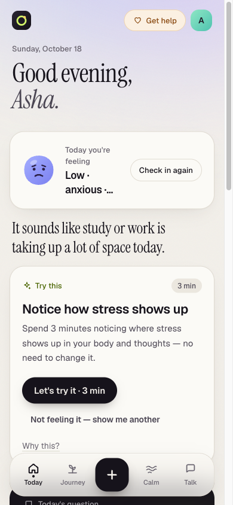
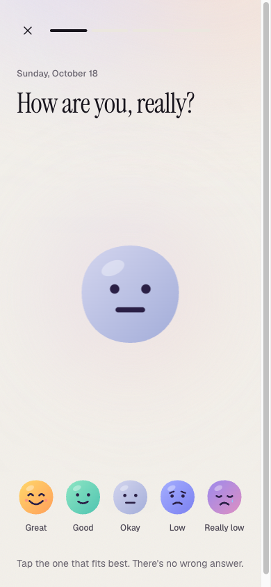
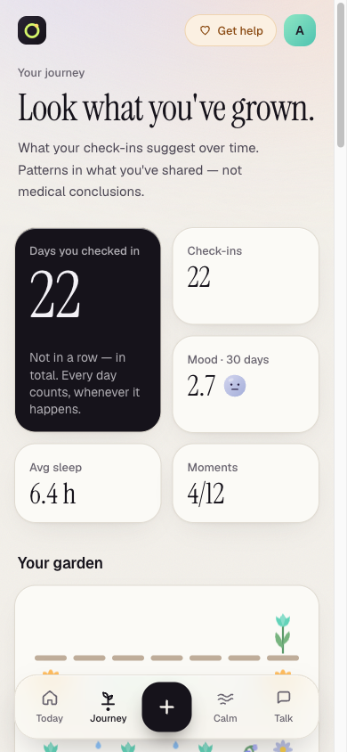
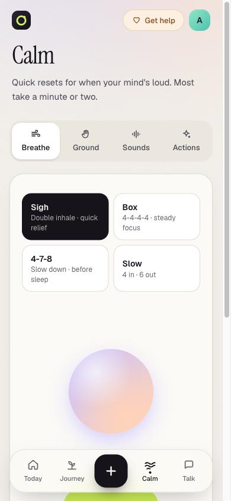
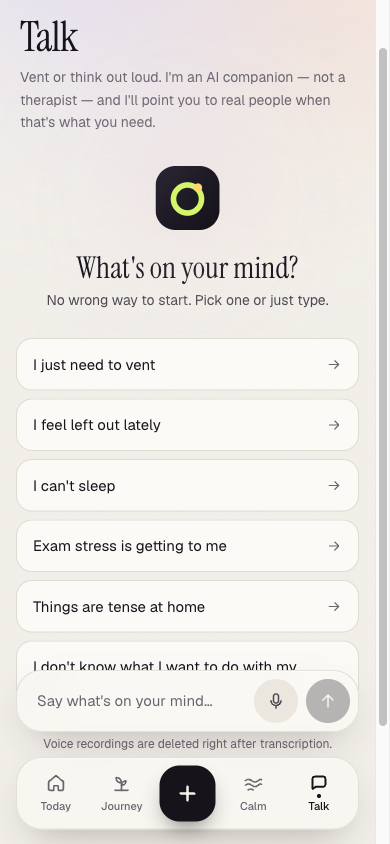

# MindLoop

A small, private wellbeing app for young adults. You check in with how you're feeling, get one
small thing to try, say whether it helped, and over time you start to see your own patterns.

It runs entirely on your own machine. The AI models are local (through [Ollama](https://ollama.com)),
so nothing you write is sent to a third-party service.

> **MindLoop is not a medical device, a therapist or an emergency service.** It doesn't diagnose
> or treat anything. If you're in danger right now, contact your local emergency number. In India
> you can call Tele-MANAS on **14416** (free, 24/7).

<table>
  <tr>
    <td></td>
    <td></td>
    <td></td>
    <td></td>
    <td></td>
  </tr>
  <tr>
    <td align="center">Today</td>
    <td align="center">Check in</td>
    <td align="center">Journey</td>
    <td align="center">Calm</td>
    <td align="center">Talk</td>
  </tr>
</table>

## What it does

- **Check in in about ten seconds.** Pick a mood, optionally a few feeling words and what it's
  about, and optionally write a sentence.
- **Get one small action.** It comes from a library of 23 short, structured exercises (breathing,
  grounding, breaking a task down and so on). The AI never makes up exercises; it only picks from
  this list.
- **See your own patterns.** Things like "On days with more sleep, your reported mood appears to
  be higher", each with a "why am I seeing this?" explanation. There are no streaks and nothing
  resets if you take a break.
- **Calm tools.** Guided breathing, 5-4-3-2-1 grounding and ambient sounds. They work without an
  account.
- **Talk.** Chat by text or voice with an AI companion that knows its limits and points you to real
  people when that's what you need.

## How it keeps people safe

- **Safety checks come first.** Every message goes through a rule-based classifier before any AI
  model sees it. If it looks like someone is at risk, the app skips the AI completely and shows
  reviewed support text with helpline numbers from the database. See [docs/SAFETY.md](mindloop/docs/SAFETY.md).
- **AI replies are checked too.** If a reply tries to diagnose, gives medication doses, claims to
  be human or promises confidentiality, it's thrown away and replaced with a safe template.
- **Private by default.** Notes, messages and transcripts are encrypted in the database. Voice
  recordings are deleted right after transcription, logs never contain what users wrote, and
  exporting or deleting your data takes one click. See [docs/PRIVACY.md](mindloop/docs/PRIVACY.md).

## Getting started

You need [Docker Desktop](https://www.docker.com/products/docker-desktop/) (or Docker Engine with
Compose v2), about 8 GB of free RAM and about 6 GB of disk space for the models.

**1. Clone the repo and create your config file**

```bash
git clone <your-repo-url> mindloop
cd mindloop
cp .env.example .env
```

**2. Generate two secrets and paste them into `.env`**

```bash
python3 -c "import secrets; print('JWT_SECRET=' + secrets.token_urlsafe(48))"
python3 -c "import base64,os; print('ENCRYPTION_KEY=' + base64.urlsafe_b64encode(os.urandom(32)).decode())"
```

**3. Start everything**

```bash
docker compose up --build -d
```

The first start downloads the AI models (about 2.8 GB), so it takes a while. You can watch it with
`docker compose logs -f ollama-pull`, and `docker compose ps` shows when `api`, `worker` and `web`
are healthy.

**4. Open http://localhost:3000**

Two demo accounts are created for you:

| Email | Password | |
|---|---|---|
| `demo@mindloop.example` | `mindloop-demo-1234` | Has 20 days of made-up history, so Journey has something to show |
| `fresh@mindloop.example` | `mindloop-demo-1234` | A brand-new, empty account |

To check that the whole stack works, run `python3 scripts/smoke_test.py`.

> **On a Mac with Apple Silicon?** Docker can't use the GPU there, so replies are slow. Install
> Ollama natively instead and it'll be about 5x faster. See
> [docs/DEVELOPMENT.md](mindloop/docs/DEVELOPMENT.md#hybrid-docker-stack--host-ollama-apple-silicon).

## Project structure

```
mindloop/
├── apps/
│   ├── api/                 Python backend (FastAPI)
│   │   ├── app/
│   │   │   ├── api/v1/          HTTP routes, one file per area
│   │   │   ├── services/        business logic
│   │   │   ├── repositories/    database queries
│   │   │   ├── models/          database tables (SQLAlchemy)
│   │   │   ├── schemas/         request and response shapes
│   │   │   ├── ai/              model calls, prompts, speech to text
│   │   │   ├── safety/          risk classifier and output checks
│   │   │   ├── interventions/   picking which action to suggest
│   │   │   ├── workers/         background job queue
│   │   │   ├── i18n/            backend text
│   │   │   └── seed/            exercises, helplines, demo data
│   │   ├── alembic/         database migrations
│   │   └── tests/
│   └── web/                 Next.js frontend (TypeScript, Tailwind)
│       ├── app/                 pages and routes
│       ├── features/            one folder per screen
│       ├── components/          shared UI
│       ├── hooks/
│       ├── lib/                 API client, auth, translations
│       └── tests/
├── docs/                    detailed documentation
├── infra/postgres/          database setup
├── scripts/smoke_test.py    end-to-end check of a running stack
└── docker-compose.yml
```

`docker compose` runs seven services: `web`, `api`, `worker`, `postgres` (with pgvector) and
`ollama`, plus two one-off jobs, `migrate` and `ollama-pull`. There's no Redis; background jobs
are stored in a Postgres table.

## Development

To run the services natively with hot reload instead of in Docker, see
[docs/DEVELOPMENT.md](mindloop/docs/DEVELOPMENT.md). The checks to run before opening a pull request:

```bash
# backend (needs the compose Postgres running: docker compose up -d postgres)
cd apps/api
uv run ruff check app tests && uv run ruff format --check app tests
uv run mypy app
uv run pytest

# frontend
cd apps/web
npm run lint && npm run typecheck && npm test && npm run build
```

The backend tests use a real Postgres database and fake AI models, so they run in a few seconds
and don't need Ollama.

### Configuration

Everything is set in `.env`; `.env.example` lists every option. The ones you're most likely to
change:

| Variable | What it does |
|---|---|
| `MODEL_CHAT` | Model that writes replies in Talk (default `qwen3:4b-instruct`) |
| `MODEL_EXTRACTION` | Model that reads check-in notes (default `qwen3:4b-instruct`) |
| `MODEL_EMBEDDING` | Embedding model for memory search (default `nomic-embed-text`) |
| `MODEL_STT` | Whisper model size for voice: `tiny`, `base`, `small`, `medium`, `large-v3` |
| `LLM_ENABLED` | Set to `false` to run without any AI model. Everything still works using rules |
| `SEED_DEMO` | Creates the demo accounts. **Turn this off in production** |

Swapping models doesn't need any code changes. See [docs/MODELS.md](mindloop/docs/MODELS.md).

## Documentation

| | |
|---|---|
| [Architecture](mindloop/docs/ARCHITECTURE.md) | How the pieces fit together and how a request flows through them |
| [Safety](mindloop/docs/SAFETY.md) | The risk classifier, crisis flow and how rules are reviewed |
| [Privacy](mindloop/docs/PRIVACY.md) | What's stored, what's encrypted and how deletion works |
| [API](mindloop/docs/API.md) | Endpoints (the full spec is in `docs/openapi.json`) |
| [Database](mindloop/docs/DATABASE.md) | Tables and migrations |
| [Models](mindloop/docs/MODELS.md) | Which AI models are used and how to change them |
| [Performance](mindloop/docs/PERFORMANCE.md) | Latency and how many model calls each feature makes |
| [Deployment](mindloop/docs/DEPLOYMENT.md) | Running it on a server |
| [Development](mindloop/docs/DEVELOPMENT.md) | Local setup without Docker, and how to add things |

## Before using this with real people

Some things can't be done in code and need qualified people:

1. **Clinical review.** Every exercise is marked `UNVERIFIED` until a professional has reviewed
   it, and the same goes for the crisis text in `apps/api/app/i18n/locales/en.json`.
2. **Helpline check.** Someone has to confirm every number in
   `apps/api/app/seed/support_resources.json` against the official source, and keep checking them.
3. **Legal review.** Terms, a privacy policy, and compliance with India's DPDP Act 2023 (and GDPR
   if you launch in the EU).
4. **Translation.** Only English is complete. Other languages need professional translators,
   especially for the safety text.
